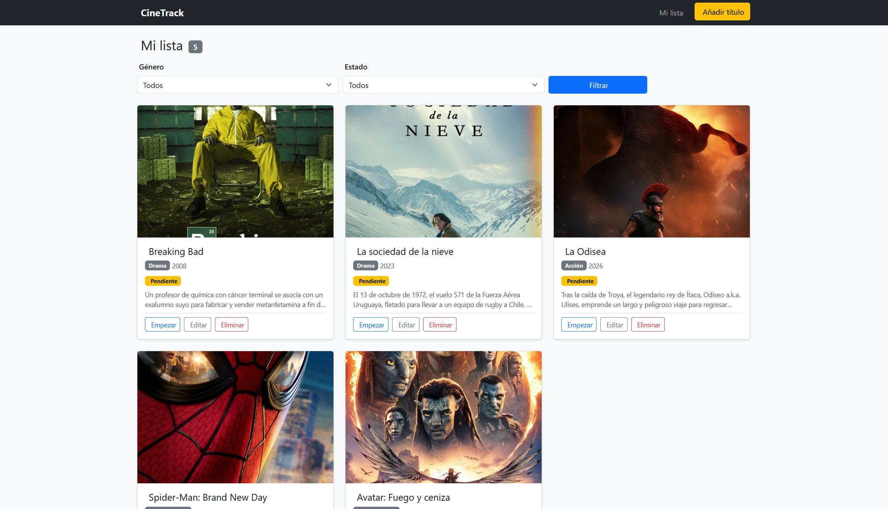

# Proyecto Kiro — SDD con Kiro IDE

> **Máster de FP en Inteligencia Artificial y Big Data**  
> Práctica: Desarrollo de una aplicación mediante SDD asistido por IA  
> Metodología: **Kiro (Specs)** · Aplicación: **CineTrack**

---

## 📁 Estructura del repositorio

```
Proyecto_Kiro/
├── README.md                        ← Este fichero
├── investigacion_kiro.md            ← Fase 1: Investigación sobre Kiro y SDD
├── flujo_trabajo_kiro.md            ← Diagramas visuales del flujo de trabajo
├── practica_sdd.pdf                 ← Enunciado de la práctica
└── app/
    ├── .kiro/                       ← Configuración de Kiro para la app
    │   ├── steering/                ← Contexto persistente del agente
    │   │   ├── conventions.md       ← Normas de código del proyecto
    │   │   ├── tech-stack.md        ← Stack tecnológico y estructura
    │   │   └── product.md           ← Contexto de negocio y funcionalidades
    │   ├── hooks/                   ← Automatizaciones por eventos del IDE
    │   │   ├── lint-on-save.json    ← Linting al guardar ficheros .py
    │   │   ├── migration-check.json ← Aviso al modificar models.py
    │   │   └── test-on-task-complete.json  ← Tests al completar tarea de spec
    │   └── specs/                   ← Especificaciones SDD
    │       ├── requirements.md      ← Historias de usuario + criterios EARS
    │       ├── design.md            ← Arquitectura, modelos, vistas, diagramas
    │       └── tasks.md             ← Lista de tareas ordenadas por dependencia
    └── src/                         ← Código fuente de la aplicación Django
        ├── requirements.txt
        ├── .env                     ← Variables de entorno (no incluido en Git)
        ├── .gitignore
        ├── pytest.ini
        ├── setup.cfg
        ├── manage.py
        ├── config/                  ← Proyecto Django
        │   ├── settings.py
        │   ├── urls.py
        │   └── wsgi.py
        └── watchlist/               ← App principal
            ├── models.py
            ├── views.py
            ├── urls.py
            ├── forms.py
            ├── services.py
            ├── admin.py
            ├── templatetags/
            │   └── watchlist_tags.py  ← Filtros custom (in_set)
            ├── templates/
            └── tests/
```

---

## 🎬 La aplicación — CineTrack

**CineTrack** es una watchlist personal de películas y series construida con Django y Python. Permite gestionar títulos con estado de visionado, puntuación por estrellas y filtrado por género, con integración directa con la API de TMDB.


## Captura de pantalla de la app

<p align="left">
  
</p>


### Funcionalidades del MVP (v1.0)

| # | Funcionalidad |
|---|---|
| F1 | Añadir película o serie con título, tipo, género, año y estado |
| F2 | Cambiar el estado de visionado: Pendiente → Viendo → Visto |
| F3 | Puntuar del 1 al 5 los títulos vistos (visualización en estrellas) |
| F4 | Filtrar la lista por género y/o estado |
| F5 | Eliminar un título con confirmación |

### Integración TMDB (v1.2 → v1.3)

A partir de la v1.2, CineTrack se integra con la **API de TMDB** (The Movie Database). Desde la v1.3, **TMDB es el único punto de entrada para añadir títulos**: el usuario busca por nombre, ve los resultados con póster, año, géneros y sinopsis, y añade el que quiera con un clic.

| # | Funcionalidad |
|---|---|
| F6 | Buscar películas y series por nombre usando TMDB |
| F7 | Ver resultados con póster, título, año y sinopsis |
| F8 | Añadir un resultado directamente a la watchlist (sin formulario manual) |
| F9 | Detección automática de duplicados: si el título ya está en la lista, el botón queda desactivado |
| F10 | Vista de detalle por título con póster grande y sinopsis completa |

### Flujo para añadir un título (v1.3)

```
Navbar "Añadir título"
        ↓
  /search/  →  escribe nombre  →  resultados TMDB con póster
        ↓
  "Añadir a mi lista"  →  título guardado en tu watchlist
```

El formulario manual (`/add/`) sigue existiendo en las URLs para uso interno o desde el panel de administración (`/admin/`), pero **no aparece en la navegación pública**.

---

## 🚀 Cómo ejecutar la aplicación

### Requisitos previos
- Python 3.11 o superior
- pip
- Una cuenta en [themoviedb.org](https://www.themoviedb.org/) con acceso a la API

### 1. Instalar dependencias

```bash
cd app/src
python -m venv venv

# Windows:
venv\Scripts\activate
# Linux/Mac:
source venv/bin/activate

pip install -r requirements.txt
```

### 2. Configurar las variables de entorno

Crea (o edita) el fichero `app/src/.env`:

```env
SECRET_KEY=tu_secret_key_de_django
DEBUG=True
TMDB_API_READ_TOKEN=eyJhbGciOiJSUzI1NiJ9...  ← token largo que empieza por eyJ
```

> **Cómo obtener el token de TMDB:**  
> 1. Ve a [themoviedb.org/settings/api](https://www.themoviedb.org/settings/api)  
> 2. En la sección **"API Read Access Token"** (no "API Key"), copia el token largo  
> 3. Pégalo en el `.env` como `TMDB_API_READ_TOKEN`

### 3. Inicializar la base de datos

```bash
cd app/src
python manage.py migrate
```

### 4. (Opcional) Crear superusuario para el admin

```bash
python manage.py createsuperuser
```

### 5. Arrancar el servidor

```bash
python manage.py runserver
```

La aplicación estará disponible en: **http://127.0.0.1:8000**  
Panel de administración: **http://127.0.0.1:8000/admin**

### Ejecutar los tests

```bash
cd app/src
pytest
```

---

## �️ Rutas de la aplicación

| URL | Nombre | Descripción |
|---|---|---|
| `/` | `title-list` | Lista principal con filtros |
| `/search/` | `tmdb-search` | **Buscar y añadir títulos vía TMDB** (punto de entrada principal) |
| `/search/add/` | `tmdb-add` | POST: guarda un resultado TMDB en la watchlist |
| `/<id>/` | `title-detail` | Detalle de un título (póster grande + sinopsis) |
| `/<id>/edit/` | `title-update` | Editar un título (estado, puntuación, notas) |
| `/<id>/delete/` | `title-delete` | Confirmar y eliminar |
| `/<id>/status/` | `title-status` | Avanzar estado (POST) |
| `/add/` | `title-create` | Formulario manual — solo acceso directo/admin |
| `/admin/` | — | Panel de administración de Django |

---

## �🔬 Cómo se ha aplicado la metodología Kiro SDD

El desarrollo siguió el flujo de trabajo de Kiro en cuatro etapas:

**1. Preparación (`app/.kiro/`)**  
Antes de escribir una línea de código se configuraron los tres pilares de Kiro: los **steering files** (convenciones, tech stack y contexto de producto), los **hooks** de automatización (lint al guardar, aviso de migraciones, tests al completar tareas) y los ficheros de configuración del proyecto.

**2. Especificación (`app/.kiro/specs/`)**  
A partir de la descripción de la aplicación en lenguaje natural, se generaron los tres documentos de spec antes de implementar nada:
- `requirements.md` — historias de usuario con criterios de aceptación en notación EARS (US-01 a US-08)
- `design.md` — arquitectura MTV, modelo de datos, URLs, wireframes y diagramas Mermaid
- `tasks.md` — tareas ordenadas por dependencia, trazadas a sus requisitos (bloques T-00 a T-18)

**3. Revisión humana**  
Los documentos fueron revisados y ajustados antes de dar la orden de implementación. Cada cambio de requisitos posterior (v1.1 plataformas, v1.2 TMDB, v1.3 TMDB como única fuente) siguió el mismo ciclo: editar specs → implementar → verificar tests.

**4. Implementación guiada**  
Kiro implementó cada tarea de `tasks.md` en orden, con los hooks verificando calidad en tiempo real.

---

## � Reparto del trabajo (referencia interna)

### Parte A — Backend (datos y lógica de negocio)
Responsable de: `config/`, `models.py`, `services.py`, `forms.py`, `admin.py`, migraciones, `requirements.txt`, `settings.py`, `.env`.

| Bloque | Tareas | Entrega |
|---|---|---|
| B0 · Inicialización | T-00 | Proyecto Django + app watchlist operativa |
| B1 · Modelo | T-01 | `Title` con campos, choices, `__str__`, migración |
| B2 · Servicios | T-02 | `get_next_status()`, `get_filtered_titles()` |
| B3 · Formularios | T-03 | `TitleForm` con validaciones y widgets Bootstrap |
| v1.1 | T-12.1–12.5 | Modelo `Platform`, ManyToMany, data migration |
| v1.2 | T-13–15 | Campos TMDB en modelo, `search_tmdb()`, `add_from_tmdb()` |

### Parte B — Frontend (vistas, plantillas y QA)
Responsable de: `views.py`, `urls.py`, `templates/`, `templatetags/`, `tests/`.

| Bloque | Tareas | Entrega |
|---|---|---|
| B4 · Templates base | T-04 | `base.html`, partials `_star_rating`, `_filter_bar`, `_title_card` |
| B5 · Vistas y URLs | T-05–09 | 5 CBVs, `urls.py`, plantillas de página |
| B6 · No funcionales | T-10 | Responsive, `aria-label`, `role="alert"` |
| B7 · Tests | T-11.4–11.5 | Tests de vistas |
| v1.1 | T-12.6–12.9 | Filtro plataforma en UI |
| v1.2–1.3 | T-16–18 | Vistas TMDB, plantillas de búsqueda/detalle, navegación unificada |

---

## 📚 Bibliografía y recursos

| Recurso | Enlace |
|---|---|
| Documentación oficial de Kiro | [kiro.dev/docs](https://kiro.dev/docs/) |
| Blog: Introducción a Kiro | [kiro.dev/blog/introducing-kiro](https://kiro.dev/blog/introducing-kiro/) |
| Blog: De chat a specs — deep dive | [kiro.dev/blog/from-chat-to-specs-deep-dive](https://kiro.dev/blog/from-chat-to-specs-deep-dive/) |
| Blog: El futuro del SDD | [kiro.dev/blog/kiro-and-the-future-of-software-development](https://kiro.dev/blog/kiro-and-the-future-of-software-development/) |
| Blog: Steering y MCP | [kiro.dev/blog/teaching-kiro-new-tricks-with-agent-steering-and-mcp](https://kiro.dev/blog/teaching-kiro-new-tricks-with-agent-steering-and-mcp/) |
| Guía completa SDD con Kiro 2026 | [pingax.com/kiro-spec-driven-development](https://pingax.com/kiro-spec-driven-development/) |
| Repositorio oficial de Kiro | [github.com/kirodotdev/Kiro](https://github.com/kirodotdev/Kiro) |
| API de TMDB | [developer.themoviedb.org](https://developer.themoviedb.org/) |
| Documentación de Django | [docs.djangoproject.com](https://docs.djangoproject.com/) |
| Bootstrap 5 | [getbootstrap.com](https://getbootstrap.com/) |
| pytest-django | [pytest-django.readthedocs.io](https://pytest-django.readthedocs.io/) |
| Presentación del proyecto | [gamma.app/docs/Desarrollo-con-IA-Spec-Driven-Development-con-Kiro-2qtpiud0scni56k](https://gamma.app/docs/Desarrollo-con-IA-Spec-Driven-Development-con-Kiro-2qtpiud0scni56k) |
