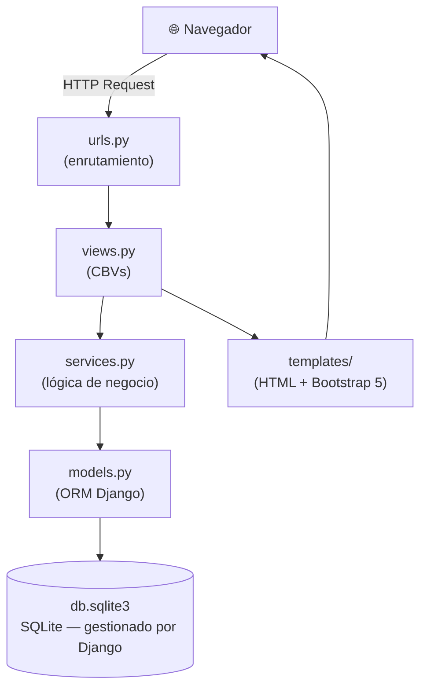
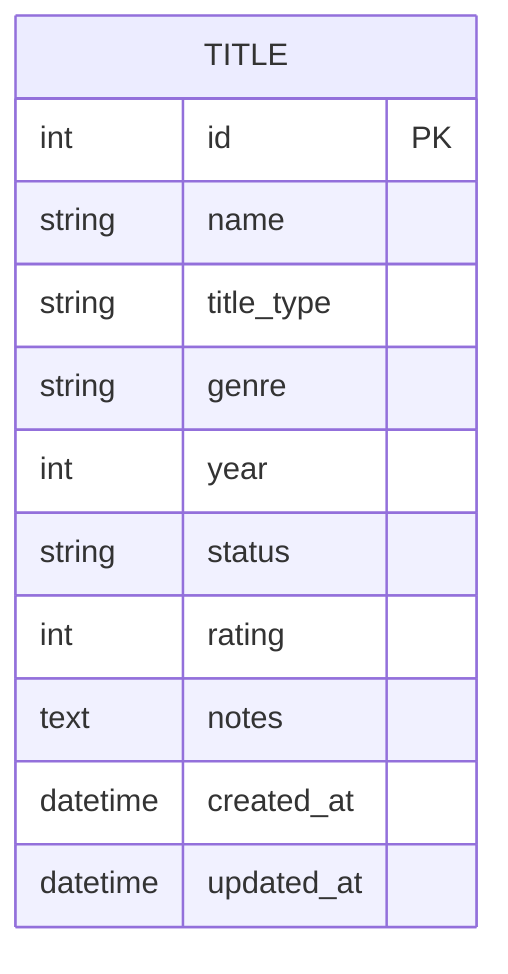
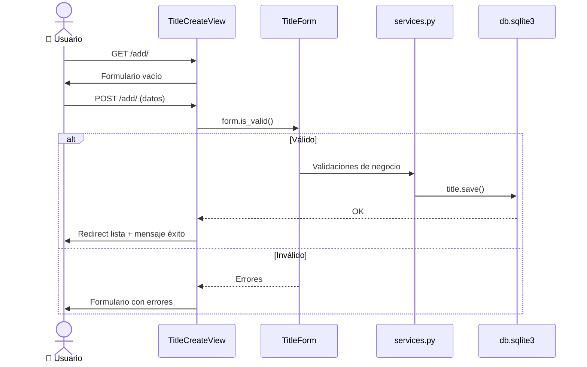
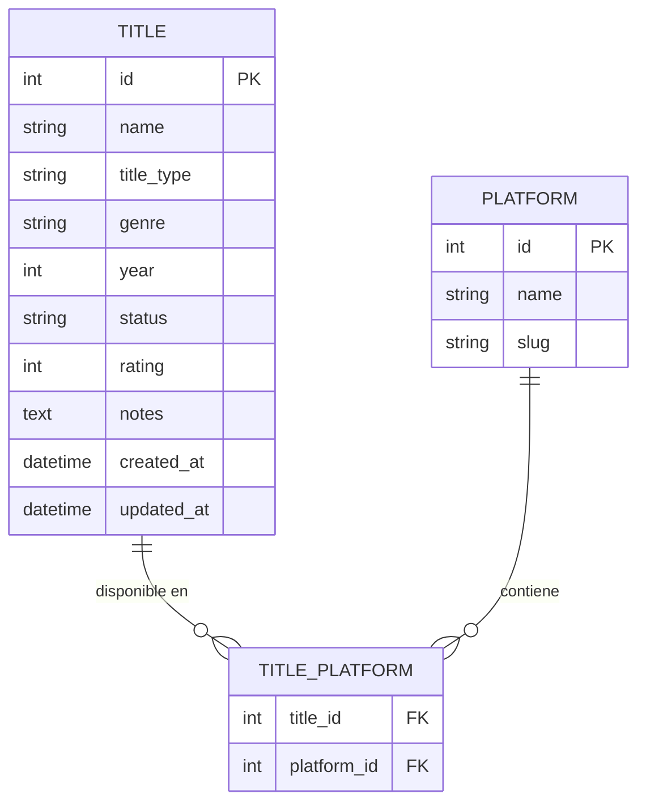
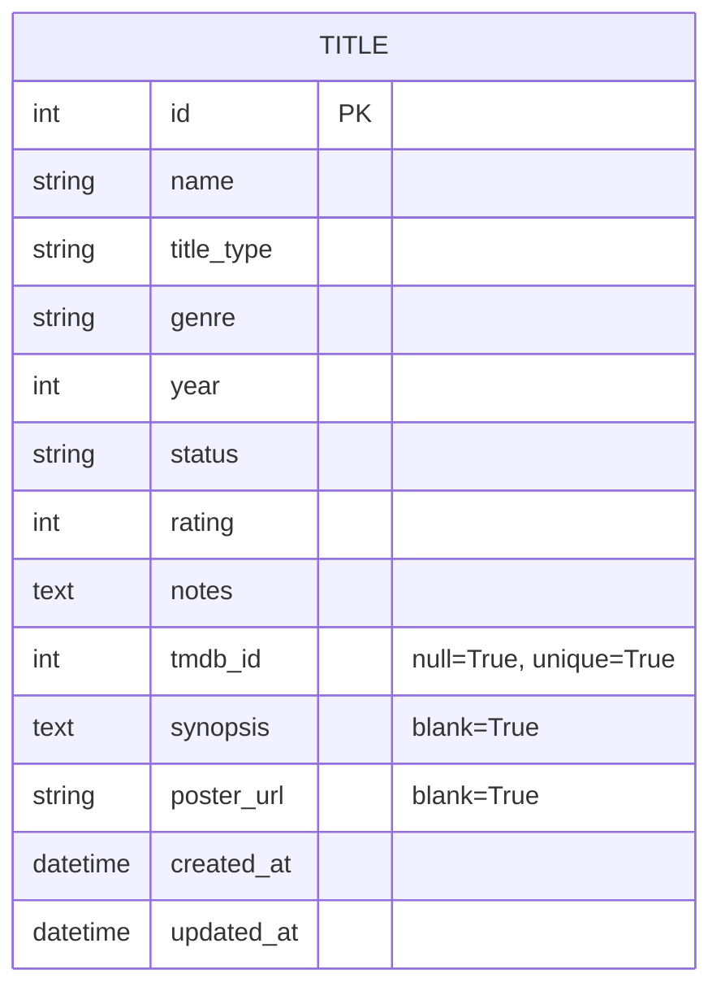
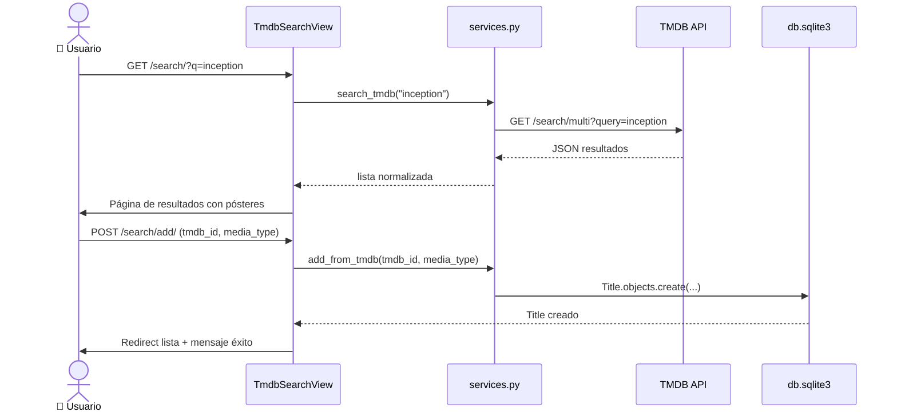

# Design — CineTrack MVP (v1.0)

> Documento de diseño técnico generado a partir de `requirements.md`  
> Stack: Python 3.11 · Django 4.2 LTS · SQLite (integrado en Django) · Bootstrap 5

---

## Arquitectura general

CineTrack sigue la arquitectura **MTV** de Django (Model – Template – View), con una capa de servicios para la lógica de negocio. La base de datos es **SQLite**, gestionada completamente por el ORM de Django — no requiere servidor externo, todo reside en un fichero `db.sqlite3` dentro del propio proyecto.



---

## Modelo de datos

### Entidad principal: `Title`

```python
class Title(models.Model):
    # Datos principales
    name        = CharField(max_length=200)           # Título obligatorio
    title_type  = CharField(choices=TYPE_CHOICES)     # "movie" | "series"
    genre       = CharField(choices=GENRE_CHOICES)    # Género predefinido
    year        = PositiveIntegerField(null=True, blank=True)

    # Estado y valoración
    status      = CharField(choices=STATUS_CHOICES, default="pending")
    rating      = PositiveSmallIntegerField(
                      null=True, blank=True,
                      validators=[MinValueValidator(1), MaxValueValidator(5)]
                  )
    # Metadatos
    notes       = TextField(blank=True)
    created_at  = DateTimeField(auto_now_add=True)
    updated_at  = DateTimeField(auto_now=True)
```

### Choices

```python
TYPE_CHOICES = [
    ("movie",   "Película"),
    ("series",  "Serie"),
]

GENRE_CHOICES = [
    ("action",       "Acción"),
    ("comedy",       "Comedia"),
    ("drama",        "Drama"),
    ("horror",       "Terror"),
    ("scifi",        "Ciencia Ficción"),
    ("documentary",  "Documental"),
    ("animation",    "Animación"),
    ("thriller",     "Thriller"),
    ("romance",      "Romance"),
    ("other",        "Otros"),
]

STATUS_CHOICES = [
    ("pending",  "Pendiente"),
    ("watching", "Viendo"),
    ("watched",  "Visto"),
]
```

### Diagrama ER — v1.0



---

## URLs y vistas (CBVs)

| URL | Nombre | View | Descripción |
|---|---|---|---|
| `/` | `title-list` | `TitleListView` | Lista con filtros por género y estado |
| `/add/` | `title-create` | `TitleCreateView` | Formulario para añadir título |
| `/<id>/edit/` | `title-update` | `TitleUpdateView` | Editar un título existente |
| `/<id>/delete/` | `title-delete` | `TitleDeleteView` | Confirmar y eliminar |
| `/<id>/status/` | `title-status` | `TitleStatusUpdateView` | Avanzar al siguiente estado |

---

## Formularios

### `TitleForm` (ModelForm)

Campos: `name`, `title_type`, `genre`, `year`, `status`, `rating`, `notes`

Validaciones en `clean()`:
- Si `status != "watched"` → limpiar `rating` a `None`
- `year` entre 1888 y año actual + 2

---

## Capa de servicios — `services.py`

```python
def get_next_status(current: str) -> str:
    """Devuelve el siguiente estado en la secuencia pending→watching→watched."""

def get_filtered_titles(genre: str | None, status: str | None) -> QuerySet:
    """QuerySet filtrado por género y/o estado, ordenado por -created_at."""
```

---

## Templates

```
templates/
├── base.html                          ← Layout raíz (navbar + Bootstrap 5)
└── watchlist/
    ├── title_list.html                ← Lista principal con barra de filtros
    ├── title_form.html                ← Crear / Editar (mismo template)
    ├── title_confirm_delete.html      ← Confirmación de borrado
    └── partials/
        ├── _title_card.html           ← Tarjeta individual de un título
        ├── _filter_bar.html           ← Selector de filtros
        └── _star_rating.html          ← Componente de estrellas (1-5)
```

### Wireframe — Lista principal

```
┌───────────────────────────────────────────────────────┐
│  🎬 CineTrack                            [+ Añadir]   │
├───────────────────────────────────────────────────────┤
│  Género: [Todos ▼]   Estado: [Todos ▼]                │
├───────────────────────────────────────────────────────┤
│  ┌─────────────┐  ┌─────────────┐  ┌─────────────┐   │
│  │ 🎬 Título   │  │ 📺 Título   │  │ 🎬 Título   │   │
│  │ Drama · 23  │  │ Acción · 22 │  │ Terror · 21 │   │
│  │ [Pendiente] │  │ [Viendo]    │  │ [Visto]     │   │
│  │ —           │  │ —           │  │ ★★★★☆       │   │
│  │ [✏️]  [🗑️] │  │ [✏️]  [🗑️] │  │ [✏️]  [🗑️] │   │
│  └─────────────┘  └─────────────┘  └─────────────┘   │
└───────────────────────────────────────────────────────┘
```

---

## Flujo de datos — Añadir un título



---

## Evolución del modelo — v1.1 (Plataformas, US-06)



Plataformas predefinidas: Netflix, HBO Max, Disney+, Prime Video, Movistar+, Otros.  
Se cargarán con un `data migration` al hacer `migrate`.


---

## Evolución del modelo — v1.2 (Integración TMDB · US-07)

### Cambio en el modelo `Title`

Se añade el campo `tmdb_id` para identificar de forma unívoca los títulos importados desde TMDB y evitar duplicados (AC-07.5). El campo es opcional para preservar la compatibilidad con títulos añadidos manualmente.

```python
tmdb_id = PositiveIntegerField(null=True, blank=True, unique=True, db_index=True)
synopsis = TextField(blank=True)  # sinopsis corta de TMDB (reutiliza notes si synopsis está vacío)
poster_url = URLField(max_length=500, blank=True)  # URL del póster de TMDB
```

### Diagrama ER — v1.2



### Nuevo servicio TMDB — `services.py`

```python
def search_tmdb(query: str) -> list[dict]:
    """Llama a /search/multi de TMDB y devuelve resultados normalizados."""

def add_from_tmdb(tmdb_id: int, media_type: str) -> Title:
    """Crea un Title desde un resultado TMDB. Lanza DuplicateTitleError si ya existe."""
```

### Nuevas URLs y vistas (v1.2)

| URL | Nombre | View | Descripción |
|---|---|---|---|
| `/search/` | `tmdb-search` | `TmdbSearchView` | Formulario de búsqueda + resultados |
| `/search/add/` | `tmdb-add` | `TmdbAddView` | POST: crea el título desde datos TMDB |

### Flujo de datos — Buscar y añadir desde TMDB



### Mapeo de géneros TMDB → GENRE_CHOICES

TMDB devuelve una lista de IDs de géneros. Se mapea al género más relevante de `GENRE_CHOICES`. Los géneros sin equivalencia directa se mapean a `"other"`.

| Géneros TMDB (id) | GENRE_CHOICES |
|---|---|
| 28 (Acción), 12 (Aventura), 10759 | `"action"` |
| 35 | `"comedy"` |
| 18, 10766 | `"drama"` |
| 27, 9648 | `"horror"` |
| 878, 10765 | `"scifi"` |
| 99 | `"documentary"` |
| 16 | `"animation"` |
| 53, 80 | `"thriller"` |
| 10749 | `"romance"` |
| resto | `"other"` |


---

## Cambio de navegación — v1.3 (US-08)

### TMDB como único punto de entrada para añadir

A partir de v1.3, el formulario manual (`/add/`) queda fuera de la navegación pública. El único flujo para añadir un título es:

```
Navbar "Añadir título"  →  /search/  →  resultados TMDB  →  POST /search/add/  →  watchlist
```

| Antes (v1.2) | Después (v1.3) |
|---|---|
| Navbar: "Buscar TMDB" + botón "Añadir" (→ `/add/`) | Navbar: un único botón "Añadir título" (→ `/search/`) |
| Estado vacío: botón "Añade tu primer título" (→ `/add/`) + "Buscar en TMDB" | Estado vacío: un único botón "Añade tu primer título" (→ `/search/`) |
| `/add/` accesible desde la UI | `/add/` existe en URLs pero sin enlace en la UI (acceso solo directo o admin) |
