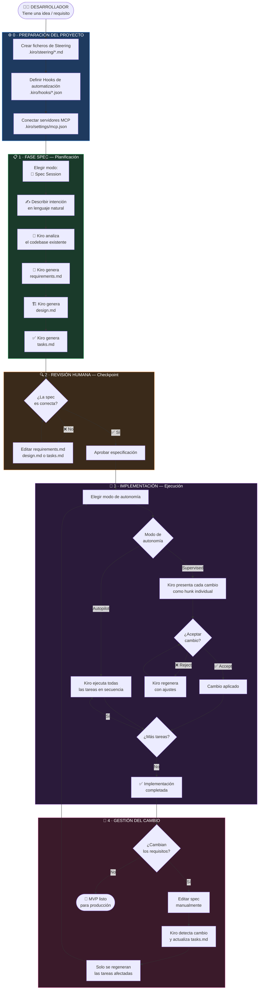
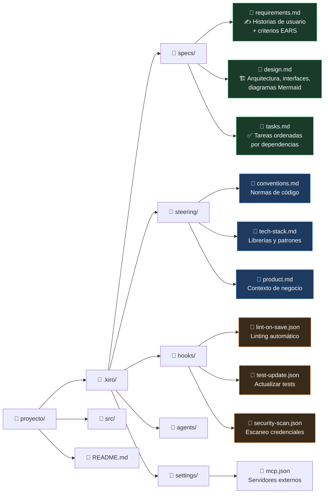
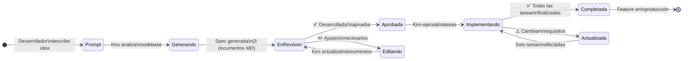
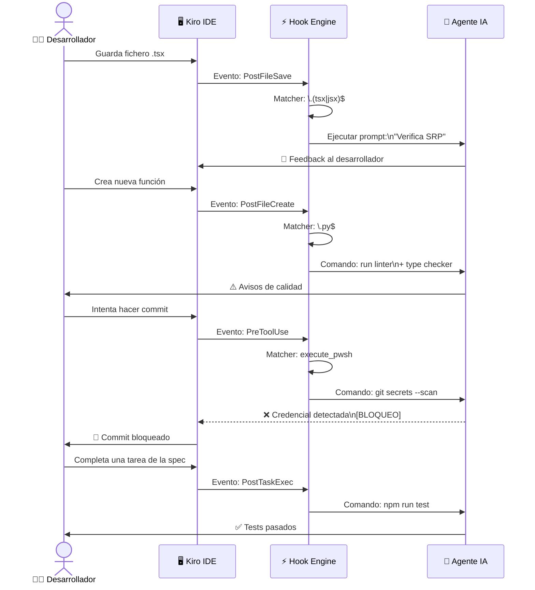
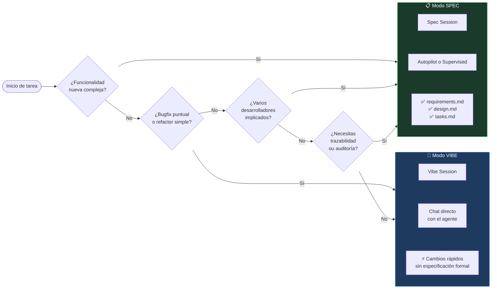
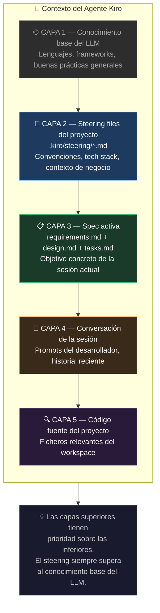
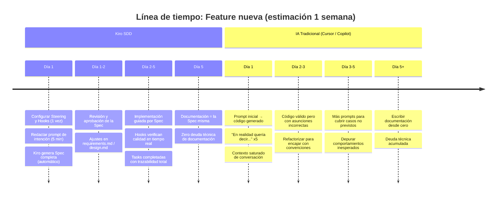

# Flujo de Trabajo Óptimo con Kiro

> Guía visual del proceso completo de **Spec-Driven Development** con Kiro IDE

---

## 🗺️ Vista General del Proceso



---

## 📁 Estructura de Ficheros del Proyecto



---

## ⚙️ Los Tres Pasos de Preparación — ¿Qué son y para qué sirven?

> Estos tres pasos se configuran **una sola vez por proyecto** y definen cómo Kiro se comportará en todas las sesiones futuras. Son la base sobre la que se apoya todo el flujo SDD.

---

### 📌 Paso 1 — Steering files · `.kiro/steering/*.md`

**Son instrucciones permanentes que Kiro lee antes de cada acción.**

Piénsalo como el *briefing que le darías a un desarrollador nuevo el primer día*: qué librerías usa el proyecto, cómo se nombran las variables, qué patrones seguimos, qué está prohibido. Sin steering, Kiro toma decisiones basándose en su conocimiento general. Con steering, toma decisiones según **tus** reglas.

A partir de estos ficheros, **todo el código que genere Kiro** seguirá esas convenciones automáticamente, sin necesidad de repetirlas en cada prompt.

**Ejemplo — `conventions.md`:**
```markdown
# Convenciones del proyecto
- Usar TypeScript estricto, nunca `any`
- Componentes React: un fichero = una responsabilidad
- Tests con Vitest, no Jest
- Nombres de funciones en inglés, comentarios en español
- Nunca hardcodear URLs — usar variables de entorno
```

Los ficheros de steering tienen cuatro modos de activación:

| Tipo | Front-matter | Cuándo se carga |
|---|---|---|
| **Siempre activo** | *(por defecto)* | En cada interacción sin excepción |
| **Por patrón de fichero** | `inclusion: fileMatch` | Solo al trabajar con ficheros que coincidan |
| **Manual** | `inclusion: manual` | Tú lo activas con `#NombreDelFichero` en el chat |
| **Automático** | `inclusion: auto` | Kiro lo activa cuando detecta que es relevante |

> 💡 **Analogía:** Es como el manual de incorporación de la empresa. Nadie lo lee en cada reunión, pero todos lo tienen interiorizado.

---

### ⚡ Paso 2 — Hooks · `.kiro/hooks/*.json`

**Son automatizaciones que se disparan cuando ocurre un evento en el IDE.**

Funcionan como un *revisor senior trabajando en segundo plano*: cada vez que guardas un fichero, creas uno nuevo o terminas una tarea, Kiro puede ejecutar acciones automáticamente. No tienes que acordarte de correr el linter, actualizar los tests o escanear credenciales — los hooks lo hacen por ti.

**Estructura de un hook:**
```json
{
  "version": "v1",
  "hooks": [{
    "name": "Lint al guardar",
    "trigger": "PostFileSave",
    "matcher": "\\.(ts|tsx)$",
    "action": {
      "type": "command",
      "command": "npm run lint"
    }
  }]
}
```

Los eventos disponibles y sus casos de uso más habituales:

| Evento | Cuándo se dispara | Uso típico |
|---|---|---|
| `PostFileSave` | Al guardar un fichero | Linting, validación de estilo |
| `PostFileCreate` | Al crear un fichero nuevo | Verificar estructura, añadir boilerplate |
| `PostFileDelete` | Al borrar un fichero | Limpiar referencias huérfanas |
| `PreToolUse` | Antes de que Kiro use una herramienta | Control de acceso, escaneo de seguridad |
| `PostToolUse` | Después de que Kiro use una herramienta | Auditoría, logging |
| `PostTaskExec` | Al completar una tarea de la spec | Ejecutar tests automáticamente |
| `SessionStart` | Al iniciar una sesión | Cargar contexto, recordatorios |
| `UserPromptSubmit` | Al enviar un mensaje al agente | Validar el prompt antes de procesarlo |

Las acciones que puede ejecutar un hook son de dos tipos:
- **`command`** — ejecuta un comando de shell (linter, tests, scripts de seguridad...)
- **`agent`** — inyecta un prompt al agente IA (revisar estilo, verificar principios de diseño...)

> 💡 **Analogía:** Es como un CI/CD local que se ejecuta en tu máquina en tiempo real, no al hacer push.

---

### 🔌 Paso 3 — MCP · `.kiro/settings/mcp.json`

**Es el fichero que conecta Kiro con herramientas y servicios externos.**

MCP (Model Context Protocol) es un protocolo abierto creado por Anthropic que permite al agente usar capacidades que van más allá del sistema de ficheros: consultar bases de datos, llamar a APIs externas, leer documentación propietaria, interactuar con servicios cloud, etc.

Sin MCP, Kiro solo puede leer/escribir ficheros y ejecutar comandos del sistema. Con MCP, puede, por ejemplo, consultar directamente el esquema de tu base de datos antes de generar una migración, o leer la documentación oficial de AWS en tiempo real.

**Ejemplo — `mcp.json`:**
```json
{
  "mcpServers": {
    "aws-docs": {
      "command": "uvx",
      "args": ["awslabs.aws-documentation-mcp-server@latest"],
      "env": {
        "FASTMCP_LOG_LEVEL": "ERROR"
      },
      "disabled": false
    }
  }
}
```

Casos de uso comunes:

| Servidor MCP | Para qué sirve |
|---|---|
| `aws-documentation` | Consultar docs de AWS en tiempo real |
| `postgresql` / `sqlite` | Leer esquemas de BD directamente |
| `github` | Gestionar PRs, issues y repos |
| `filesystem` extendido | Acceso a rutas fuera del workspace |
| Documentación interna | Conectar wikis o APIs propietarias del equipo |

> 💡 **Analogía:** Son como los plugins o integraciones del agente — amplían lo que puede "ver" y "hacer" más allá del código fuente.

---

### 🧩 Los tres en conjunto

```
┌─────────────────────────────────────────────────────────────┐
│                    PROYECTO CON KIRO                        │
│                                                             │
│  📌 STEERING          ⚡ HOOKS            🔌 MCP            │
│  "¿Cómo trabajamos?"  "¿Qué pasa auto-   "¿Con qué habla   │
│                        máticamente?"      el agente?"       │
│                                                             │
│  Manual de equipo     CI/CD local         Plugins/APIs      │
│  Convenciones         Calidad continua    Contexto externo  │
│  Tech stack           Tests, lint         BD, docs, cloud   │
└─────────────────────────────────────────────────────────────┘
```

Configurados los tres, Kiro tiene todo el contexto necesario para trabajar de forma coherente con tu proyecto desde el primer prompt de cada sesión.

---

## 🔄 Ciclo de Vida de una Spec



---

## ⚡ Sistema de Hooks — Cuándo se disparan



---

## 🧭 ¿Cuándo usar cada modo?



---

## 🏗️ Capas de Contexto del Agente



---

## 📊 Comparativa: SDD vs. Desarrollo tradicional con IA



---

## ✅ Checklist del Flujo Óptimo

```mermaid
graph LR
    subgraph SETUP ["⚙️ Setup (solo 1 vez por proyecto)"]
        C1["☐ Crear .kiro/steering/conventions.md\ncon normas de código del equipo"]
        C2["☐ Crear .kiro/steering/tech-stack.md\ncon librerías y patrones"]
        C3["☐ Definir hooks de calidad\n(lint, tests, seguridad)"]
        C4["☐ Conectar MCPs necesarios\n(BD, APIs, docs externas)"]
    end

    subgraph PER_FEATURE ["🔁 Por cada funcionalidad"]
        C5["☐ Abrir sesión en modo Spec"]
        C6["☐ Redactar intención clara\n(qué, no cómo)"]
        C7["☐ Revisar requirements.md\n¿Cubre todos los casos?"]
        C8["☐ Revisar design.md\n¿Arquitectura coherente?"]
        C9["☐ Revisar tasks.md\n¿Orden y dependencias OK?"]
        C10["☐ Elegir Autopilot o Supervised\nsegún la criticidad"]
        C11["☐ Ejecutar tareas\nuna a una o en bloque"]
        C12["☐ Verificar que los hooks\nno reportan errores"]
    end

    SETUP --> PER_FEATURE

    style SETUP fill:#1e3a5f,color:#fff,stroke:#4a9eff
    style PER_FEATURE fill:#1a3a2a,color:#fff,stroke:#4ade80
```



---

## 🔗 Referencias

| Recurso | Enlace |
|---|---|
| Documentación oficial | [kiro.dev/docs](https://kiro.dev/docs/) |
| Introducción a Kiro | [kiro.dev/blog/introducing-kiro](https://kiro.dev/blog/introducing-kiro/) |
| Deep dive: de chat a specs | [kiro.dev/blog/from-chat-to-specs-deep-dive](https://kiro.dev/blog/from-chat-to-specs-deep-dive/) |
| Guía completa SDD 2026 | [pingax.com/kiro-spec-driven-development](https://pingax.com/kiro-spec-driven-development/) |
| Repositorio oficial | [github.com/kirodotdev/Kiro](https://github.com/kirodotdev/Kiro) |

---
